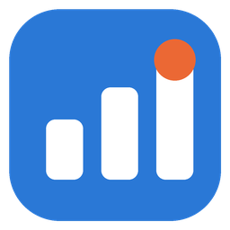
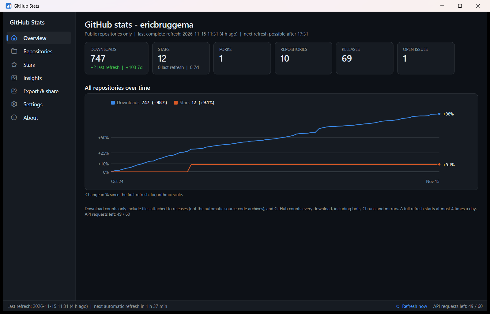
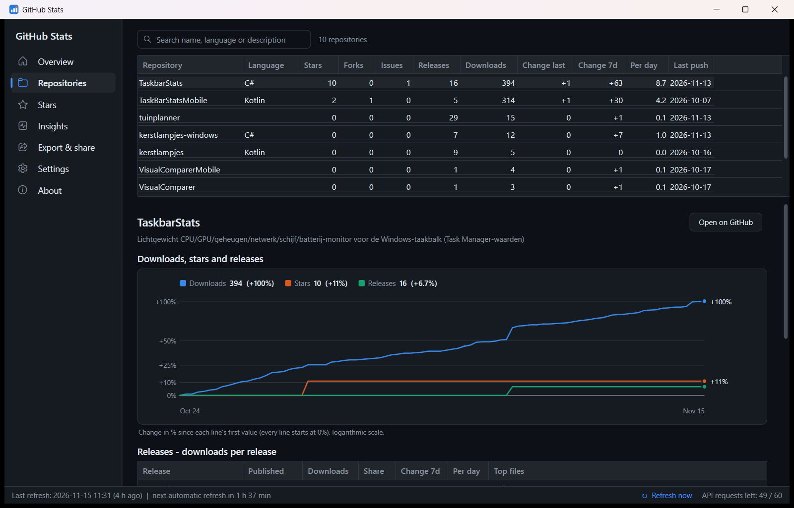
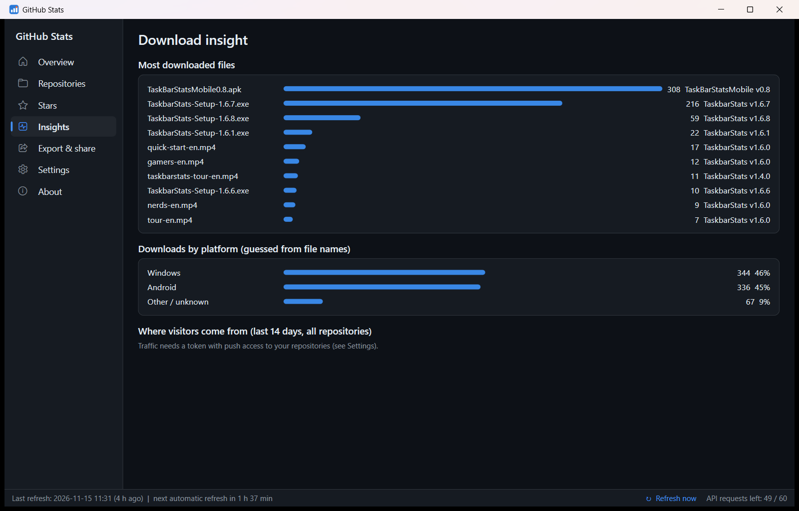
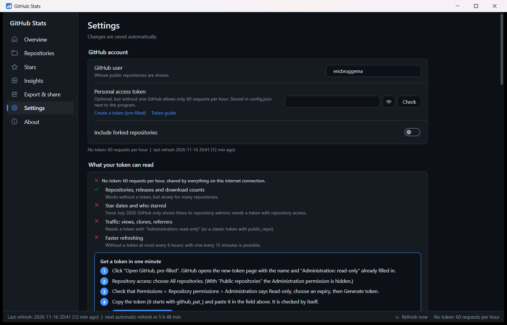
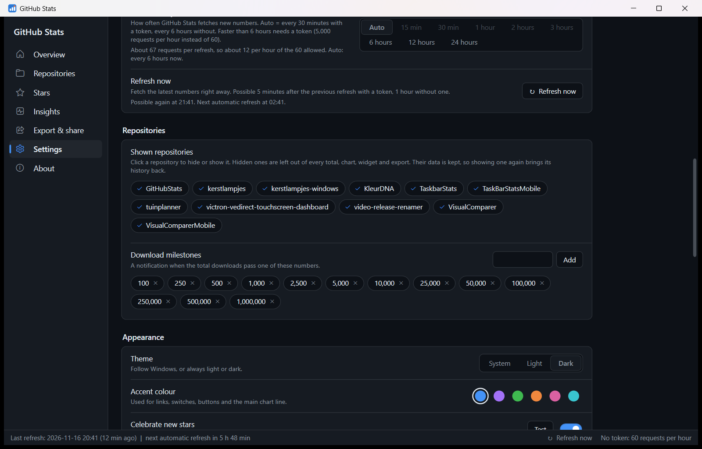
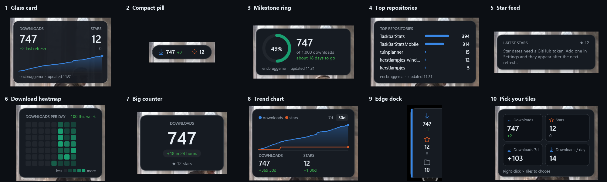
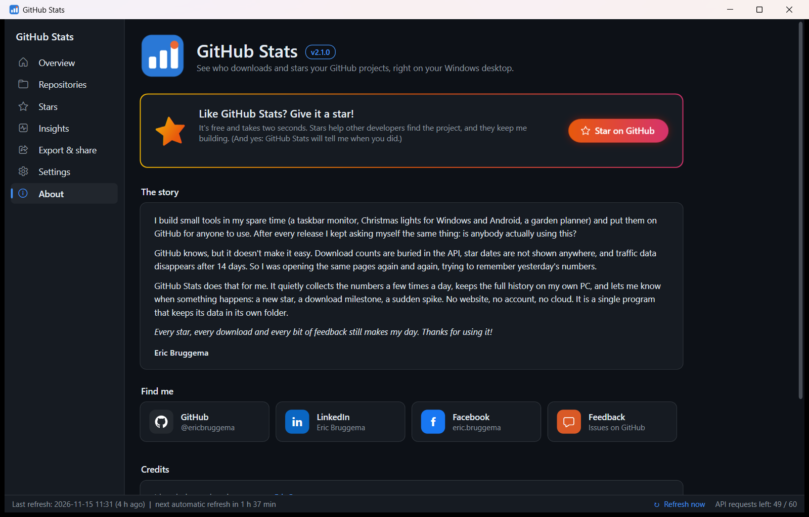

# GitHub Stats

**See who downloads and stars your GitHub projects, right on your Windows desktop.**

[**Download**](https://github.com/ericbruggema/GitHubStats/releases/latest) ·
[Installation](docs/INSTALL.md) ·
[User guide](docs/USER-GUIDE.md) ·
[Token guide](docs/TOKEN.md) ·
[FAQ](docs/FAQ.md)

---

## Why?

GitHub knows how often your releases are downloaded, when every star arrived and where your visitors come from.
It just doesn't show it to you in one place: download counts are hidden in the API, star dates aren't shown
anywhere, and traffic data disappears after 14 days.

**GitHub Stats** is a small native Windows program that collects all of this a few times a day, keeps the full
history on your own PC and tells you when something happens. No website, no account, no cloud.

## Features

| | |
|---|---|
| 📈 **History that never expires** | Downloads per repository, per release and per file, stars, forks and traffic. Kept forever, even after GitHub drops the last 14 days. |
| ⭐ **Real star dates** | Who starred what, and when, with a recent-stars list and a taskbar badge for new ones. |
| 🎆 **Celebrations** | Fireworks and a "+N" on your screen when someone stars a project. Notifications for download milestones you choose. |
| 🔎 **Repositories at a glance** | Sortable table with change since the last refresh, last 7 days and per day. Search box, and a chart per repository. |
| 🧭 **Insights** | Most downloaded files, downloads per platform (Windows / Android / ...), top referrers and popular pages. |
| 🖥️ **Lives in your tray** | Tray icon with a hover card, a desktop widget in **10 styles** (glass card, milestone ring, heatmap, edge dock, ...), taskbar progress and badge, start with Windows. |
| 📤 **Export & share** | CSV (Excel-ready), JSON, a stand-alone web page, a README block and SVG badges, written to a folder after every refresh. |
| 🙈 **Hide repositories** | Leave test or archived repos out of every total without losing their data. |
| 💾 **Backup & restore** | One zip with your settings and all history. |
| 🎨 **Light, dark & accent colours** | Follows Windows, or pick light, dark and one of six accent colours. |
| 🔒 **Portable & private** | One `.exe`. Settings and data live next to it. Nothing is sent anywhere except the GitHub API. |
| 🛡️ **Gentle on GitHub** | Refresh as often as your token allows: every 30 minutes with a token (adjustable, down to 15), every 6 hours without. Resumes cleanly after a rate limit. |
| 🔑 **Token check** | Shows what your token is, when it expires and what it may read, with a pre-filled GitHub link for anything missing. |

## Screenshots

<table>
<tr>
<td width="50%"> <b>Repositories</b>: search, sort and a chart per repo</td>
<td width="50%"> <b>Insights</b>: top files and downloads per platform</td>
</tr>
<tr>
<td> <b>Settings</b>: token test, data options, auto-save</td>
<td> <b>Hide repositories</b>, milestones and accent colours</td>
</tr>
<tr>
<td colspan="2"> <b>Desktop widget</b>: ten styles to choose from</td>
</tr>
<tr>
<td colspan="2" align="center"> <b>About</b></td>
</tr>
</table>

## Installation

1. Download **`GitHubStats-x.y.z-Setup.exe`** from the [latest release](https://github.com/ericbruggema/GitHubStats/releases/latest).
2. Run it. No administrator rights are needed; it installs for your user only.
3. Start **GitHub Stats**, open **Settings**, enter your GitHub username, and optionally a [token](docs/TOKEN.md).

Prefer no installer? Download **`GitHubStats-x.y.z-portable.zip`**, unzip it anywhere (even a USB stick) and run
`GitHubStats.exe`. See the [installation guide](docs/INSTALL.md) for details, updating and uninstalling.

> **Updating never touches your data.** The installer only replaces the program. `config.json`, the `data`
> folder and your publish folder are never overwritten.

## Quick start

1. **Settings → GitHub user**: the account whose public repositories you want to follow.
2. **Settings → Personal access token** *(recommended)*: paste a token, then press **Test** to see what it unlocks.
   The [token guide](docs/TOKEN.md) explains which kind to create.
3. Wait for the first refresh (the status bar shows the progress), or press **↻ Refresh now**.
4. Explore **Overview**, **Repositories**, **Stars** and **Insights**. Read the [user guide](docs/USER-GUIDE.md) for everything else.

## Documentation

| Guide | What's in it |
|---|---|
| [Installation](docs/INSTALL.md) | Installer vs. portable, updating, uninstalling, where your data lives |
| [Token](docs/TOKEN.md) | Why a token helps, classic vs. fine-grained, which permissions for traffic |
| [User guide](docs/USER-GUIDE.md) | Every screen and setting explained |
| [FAQ](docs/FAQ.md) | Common questions and troubleshooting |
| [Building](docs/BUILDING.md) | Build from source, make the installer |
| [Changelog](CHANGELOG.md) | What changed in each version |

## Privacy

GitHub Stats only talks to `api.github.com` (and checks this repository for new versions once a day, which you
can switch off). There is no telemetry. Your token is stored in `config.json` next to the program, on your own PC.

## ⭐ Like it?

If GitHub Stats is useful to you, **[give it a star](https://github.com/ericbruggema/GitHubStats)**. It helps other
developers find it and keeps me building. (And yes: GitHub Stats will tell me when you did. 🎆)

Questions, ideas or just want to say hi? Find me on [GitHub](https://github.com/ericbruggema),
[LinkedIn](https://www.linkedin.com/in/eric-bruggema-28a81a186/) or [Facebook](https://www.facebook.com/eric.bruggema),
or open an [issue](https://github.com/ericbruggema/GitHubStats/issues).

## License

[MIT](LICENSE) © Eric Bruggema. Built with [Claude Code](https://claude.com/claude-code).
