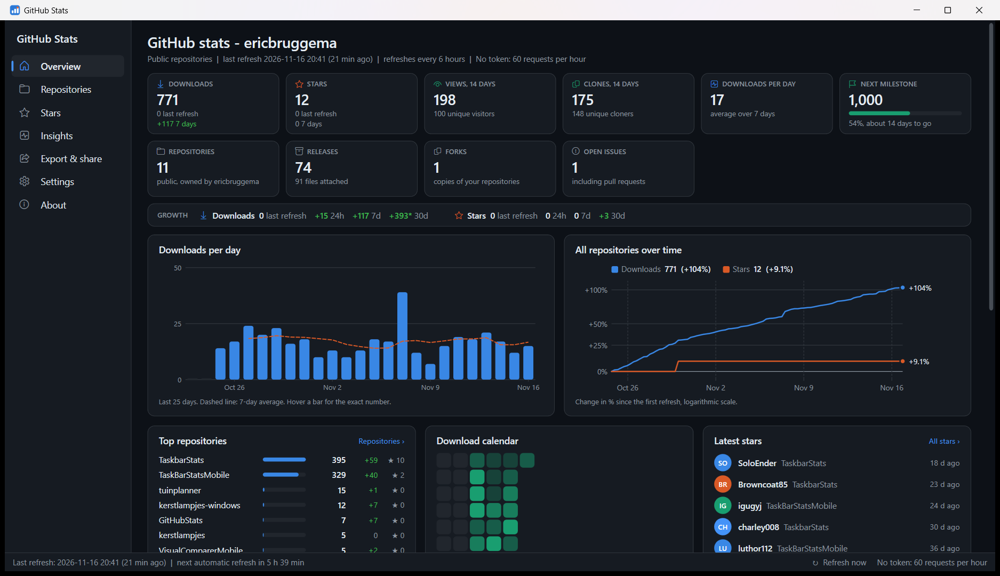
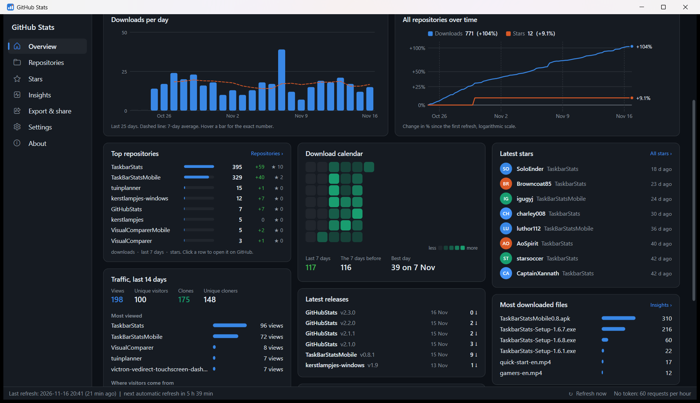
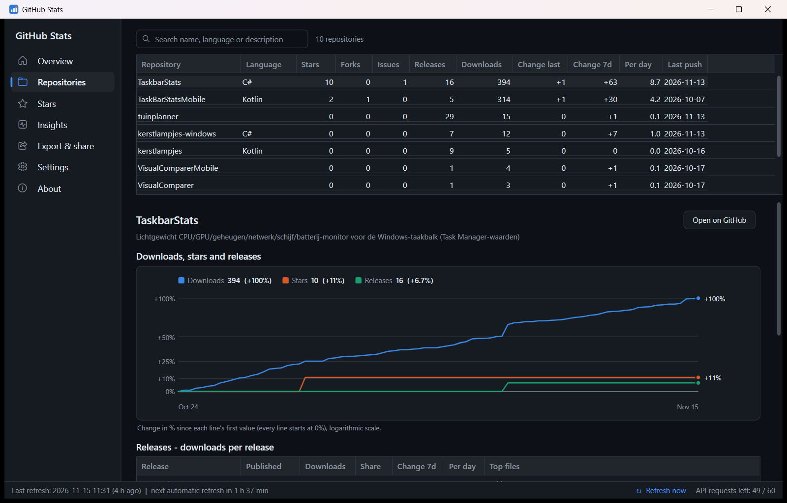
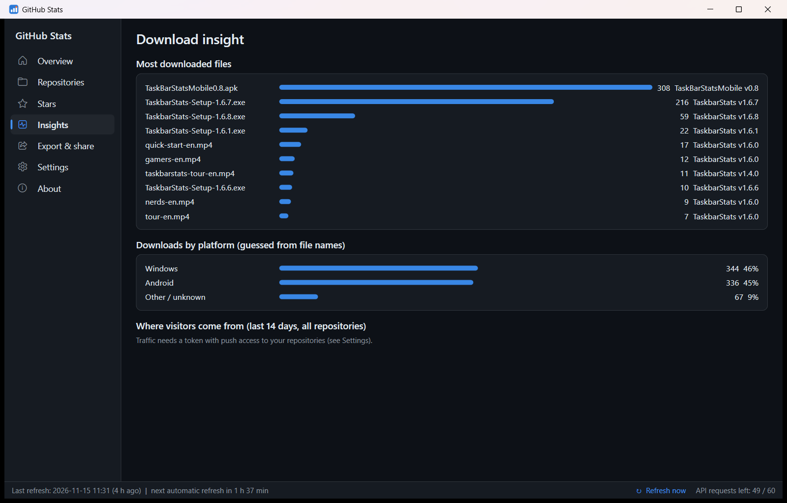
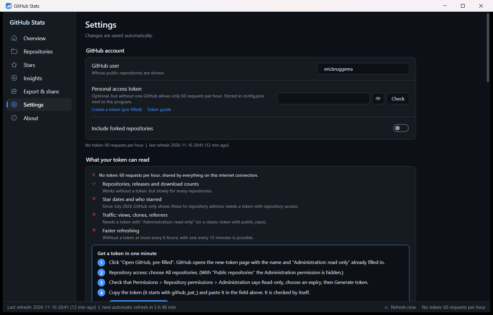
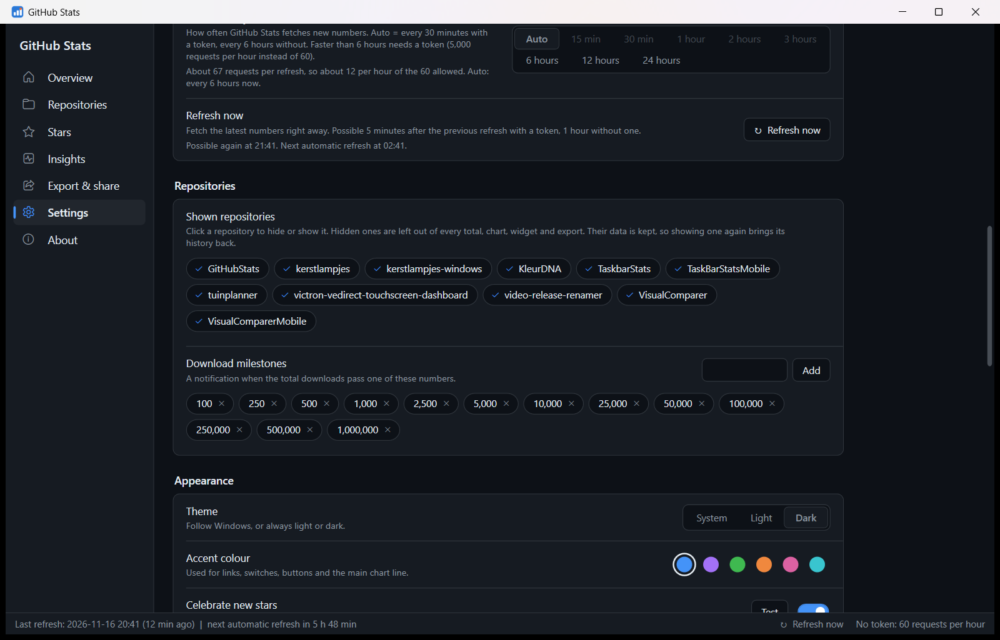
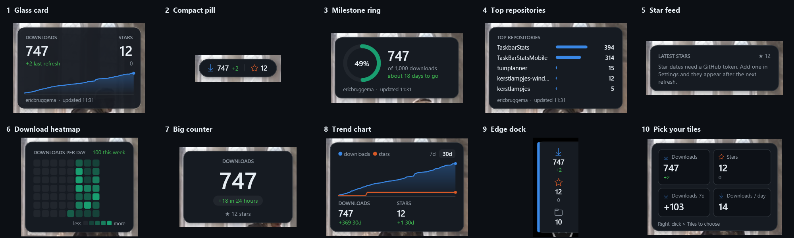

# User guide

- [How refreshing works](#how-refreshing-works)
- [Overview](#overview)
- [Repositories](#repositories)
- [Stars](#stars)
- [Insights](#insights)
- [Export & share](#export--share)
- [Settings](#settings)
- [Tray icon, widget and notifications](#tray-icon-widget-and-notifications)
- [Backup and restore](#backup-and-restore)

---

## How refreshing works

GitHub Stats asks GitHub for new numbers on a schedule you choose in **Settings → Data → Refresh every**:

| | Without a token | With a token |
|---|---|---|
| **Auto** (default) | every 6 hours | every 30 minutes |
| Fastest you can choose | 6 hours | 15 minutes |
| **↻ Refresh now** possible | 1 hour after the previous refresh | 5 minutes after the previous refresh |

The setting shows how many API requests a refresh costs and how much of your hourly limit that uses.
Every refresh stores a snapshot, and those snapshots make the charts and the *change last / 7d / per day* columns.
The last 2 days keep every snapshot; older history keeps one per 6 hours, so frequent refreshing never pushes old
history out.

- **Background refresh** (Settings → Data): on = refresh by itself while the program runs. Off = only
  when you open the window.
- **↻ Refresh now**: in the status bar, in **Settings → Data**, in the tray menu and in the widget's right-click menu.
  Hover over it (or look in Settings) to see when it is possible again.
- The status bar shows the last refresh, a live countdown to the next one and how many API requests are left.
- If GitHub's rate limit is reached, the refresh pauses and continues by itself when the limit resets. Nothing is lost.

## Overview

Everything on one page:

- **Cards**: downloads, stars, views and clones (14 days, with unique visitors and cloners), downloads per day,
  next milestone with a progress bar, repositories, releases, forks and open issues.
- **Growth**: one line with downloads and stars since the last refresh, in 24 hours, 7 days and 30 days
  (`*` = not enough history yet for the whole period).
- **Downloads per day**: a bar per day with a dashed 7-day average. Hover a bar for the exact number.
- **All repositories over time**: the running totals, with dates along the bottom. **Hover over a chart** to see the
  exact numbers for that moment.
- **Panels**: top repositories, downloads per day (heatmap), latest stars, traffic (most viewed, referrers), latest
  releases, most downloaded files, platforms and highlights. They fill as many columns as the window is wide; click a
  row to open it on GitHub.

## Repositories

- **Search** by name, language or description. Press **Esc** to clear.
- **Sort** by clicking a column header.
- **Select** a row to see that repository below: downloads, stars and releases over time, traffic, top referrers,
  popular pages and downloads per release.
- **Double-click** a repository or release to open it on GitHub.
- Drag the bar between the table and the details to resize them.

## Stars

The latest stars across all repositories: when, which repository and who. This needs a token (see the
[token guide](TOKEN.md)) and appears after the first complete refresh.

## Insights

- **Most downloaded files**, with the release they belong to.
- **Downloads by platform**, guessed from file names (`.exe` and `.msi` = Windows, `.apk` = Android, ...).
- **Where visitors come from** (last 14 days, all repositories): needs a token with push access.

## Export & share

- **Save as file:** CSV for repos, releases, assets, history, stars and traffic (opens correctly in Excel),
  JSON with or without history, or a stand-alone web page (`stats.html`).
- **README block:** a Markdown table to paste into your profile README. Click **Copy**.
- **Publish folder:** after every refresh, `stats.md`, `stats.html`, `stats.json`, the CSV files and SVG badges are
  written to this folder, ready to commit or upload. Set the folder in **Settings → Publish folder**
  (empty = off).

## Settings

Everything is **saved automatically**. A green *✓ Saved* appears at the top.

| Section | Setting | What it does |
|---|---|---|
| GitHub account | GitHub user | Whose public repositories are shown |
| | Personal access token | See the [token guide](TOKEN.md). **Test** shows what it unlocks |
| | Include forked repositories | Also count your forks |
| Data | Star dates and stargazers | *Auto* = only with a token |
| | Traffic history | *Auto* = only with a token (needs push access) |
| | Refresh in the background | See [How refreshing works](#how-refreshing-works) |
| Repositories | Shown repositories | Click a chip to **hide** a repository from every total, chart, widget and export. Its data is kept |
| | Download milestones | Get a notification when total downloads pass one of these. Type `750`, `1,500` or `2k` and press **Add** |
| Appearance | Theme | System, light or dark |
| | Accent colour | Links, switches, buttons and the main chart line |
| | Celebrate new stars | Fireworks and *+N* on screen. **Test** shows them |
| Startup and tray | Start with Windows | Starts quietly in the tray when you sign in |
| | Tray icon, keep running when closed, start hidden, hover card, notifications | See below |
| Desktop widget | Show, always on top, opacity | See below |
| Publish folder | Folder | Where exports are written after each refresh. **Browse...** to choose |
| Backup | Make backup / Restore | See below |
| Program | Updates | Check for a new version on start (once a day), or **Check now** |

## Tray icon, widget and notifications

- **Tray icon:** click to open the window, right-click for a menu. With **Hover card** on, hovering shows
  a card with all the numbers.
- **Keep running when closed:** closing the window hides it to the tray, so refreshes and notifications keep going.
- **Notifications:** new stars and download milestones (needs the tray icon).
- **Desktop widget:** drag it anywhere (it remembers its place), double-click to open the main window. It stays on the
  desktop when you press Win+D. Right-click for **Style** (ten looks), **Size**, **Keep on top** and **Opacity**:

  

  *Pick your tiles* has a **Tiles** submenu (up to 6 metrics). *Edge dock* sticks to the right edge of the screen and
  slides away after 1.5 seconds without the mouse (switch that off with **Slide away when not in use**).
- **Taskbar:** a progress bar while refreshing, and a badge with the number of new stars you haven't seen yet.

## Backup and restore

- **Make backup...** saves one zip with `config.json` (including your token) and the whole `data` folder.
- **Restore...** asks for confirmation, saves your current data as `backup-before-restore-<date>.zip` next to the
  program, restarts GitHub Stats and puts the backup in place. If you change your mind, restore that zip.

Moving to a new PC? Make a backup, install GitHub Stats on the new PC, and restore the backup there.
